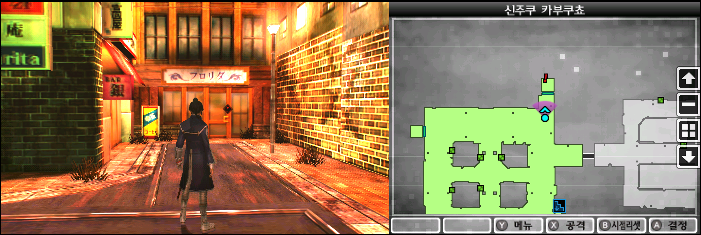
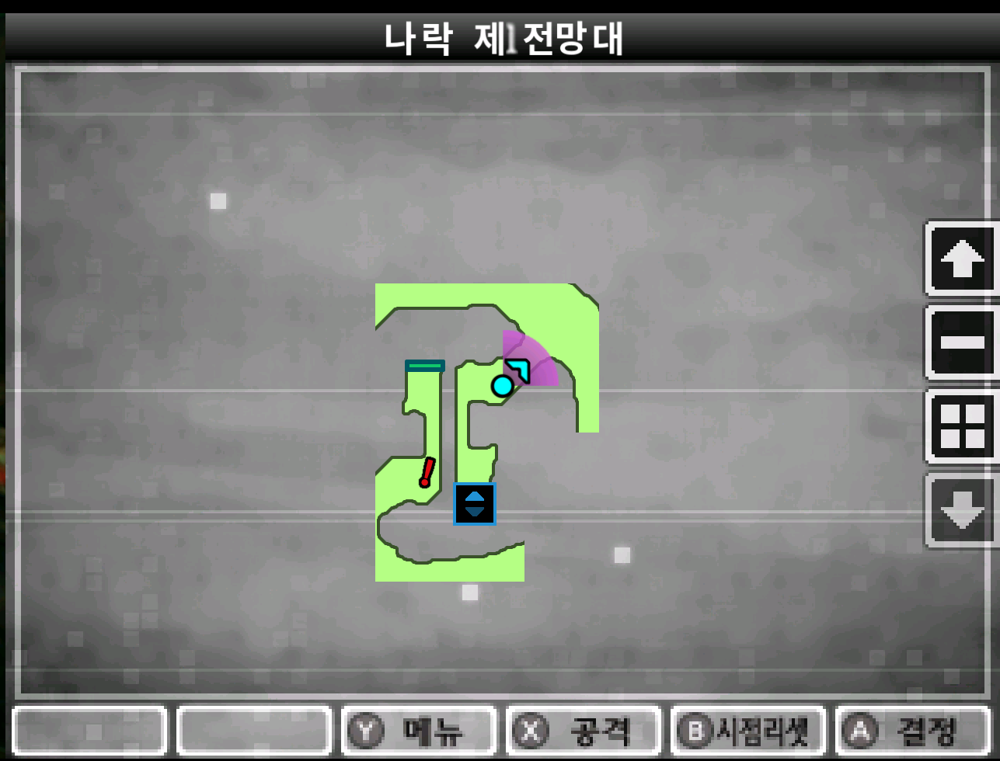
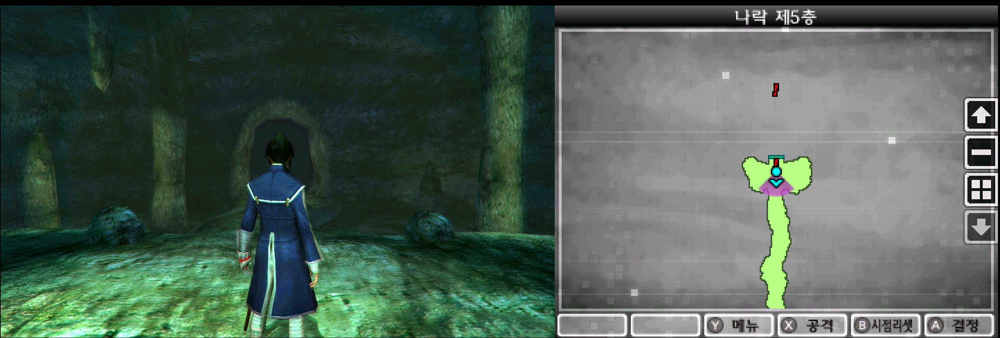
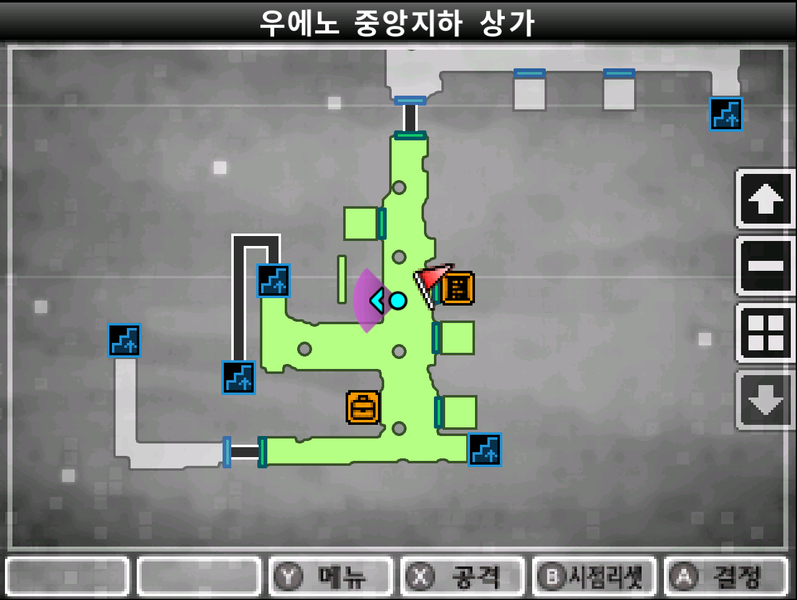
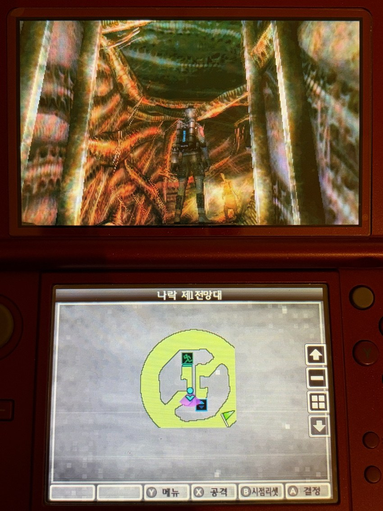
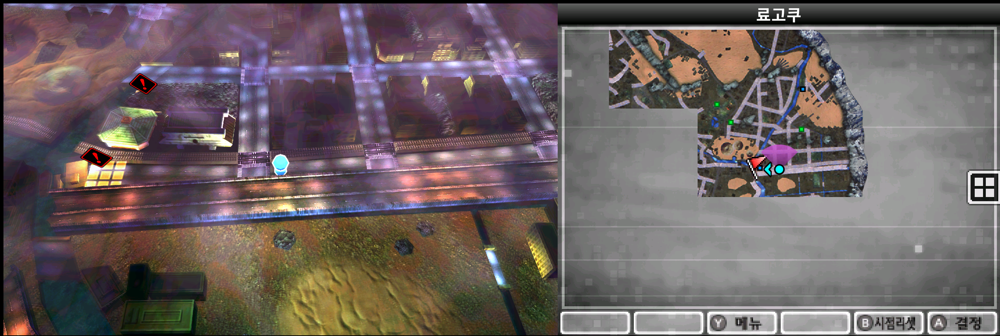
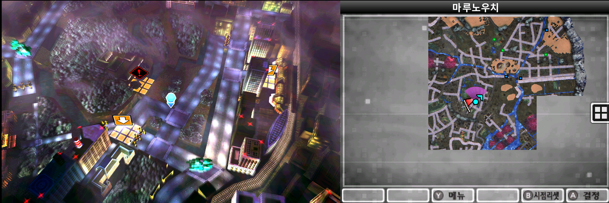
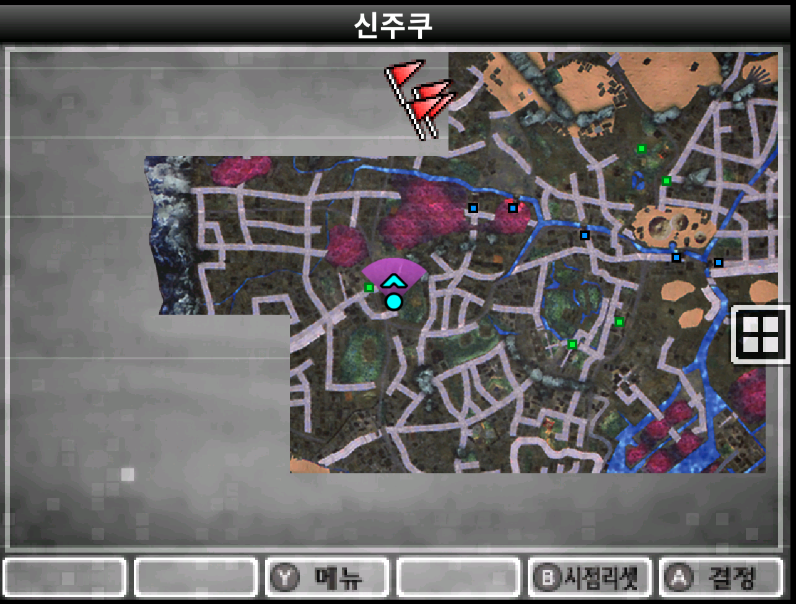
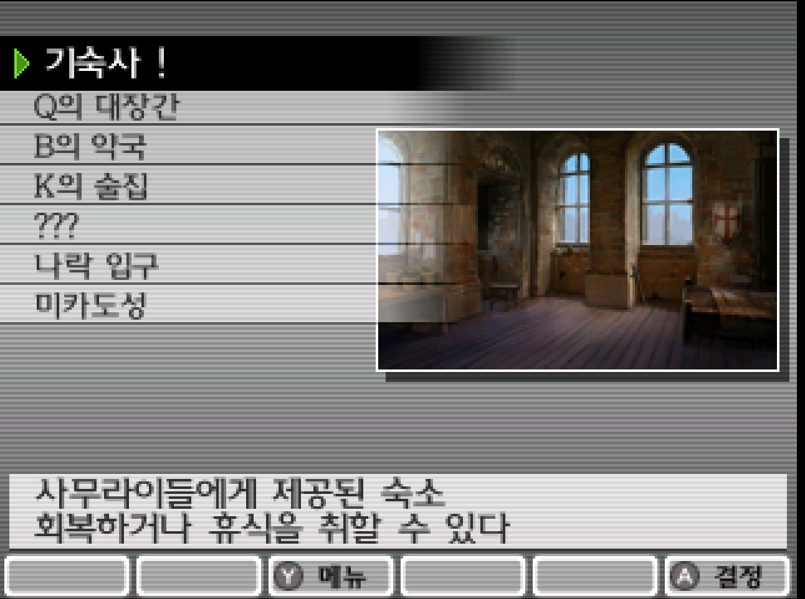

# Shin Megami Tensei IV (Korean Release) Quest Marker Mod

[한국어](README.md) | **English**

**SMT IV KR Quest Markers** is a mod for the official Korean release of *Shin Megami Tensei IV* (3DS). It **marks story event locations on the in-game map with the destination flags from *Shin Megami Tensei IV: Apocalypse***.

*SMT IV: Apocalypse* shows quest destinations on the map, but the original *SMT IV* does not, so it is easy to lose track of where to go next. This mod reads the event trigger locations stored in the game data and draws the events you can currently trigger **directly on the in-game map**.


<sub>Shinjuku Kabukicho. A flag marks the entrance of Café Florida, the next destination.</sub>

---

## Features

### 1. Destination flags on the map
- Story events you can currently trigger are marked with **the same red flag as in Apocalypse**. When you zoom the map out, it switches to a small flag.
- Flags disappear automatically once you have seen the event. They follow the game's own event flags.
- Destinations in **areas you have not explored yet** are shown too.

<p align="center">
  
  &nbsp;
  
</p>
<p align="center"><sub>Left: Naraku 1st Observatory &nbsp;|&nbsp; Right: Naraku 5F. Destinations in unexplored grey areas are visible as well.</sub></p>

<p align="center">
  
  <br><sub>Ueno Central Underground Mall. For quests you receive by talking to an NPC, a flag stays at that building's entrance until you talk to them.</sub>
</p>

- **Challenge quest** events with a fixed location are shown with a **green flag**.

<p align="center">
  
  <br><sub>Naraku 1st Observatory. A green flag marks a challenge quest event (real 3DS).</sub>
</p>

- Events clustered in the same spot are merged into a single flag.
- Minor events, such as townspeople's dialogue updates, are not shown.

### 2. Flags on the Tokyo field map
- On the Tokyo field map, only the destination of the **main quest you are currently on** is flagged. If the destination is inside a city or building, the flag appears at its entrance.
- When several main quests overlap, they are shown one at a time in story order. Once you finish a step, the flag moves to the next destination.

<p align="center">
  
  &nbsp;
  
</p>
<p align="center"><sub>Left: after defeating Fiarey, a flag at the bridge event in Ryogoku &nbsp;|&nbsp; Right: after crossing the bridge, the flag has moved to the next destination's entrance</sub></p>

- If a city that holds an event or quest destination has several entrances, every entrance gets a flag.

<p align="center">
  
  <br><sub>Ikebukuro. The destination city has several entrances, so several flags are shown.</sub>
</p>

### 3. Markers in Mikado (the menu-driven town)
In towns where you pick a location from a menu, a symbol is added after the location name.

| Display | Meaning |
|---|---|
| `빵집 ！` (Bakery) | A main event is available |
| `기숙사 ＊` (Dormitory) | An event that can only be seen at this point in the story |
| (no symbol) | A minor event, or no event |

<p align="center">
  
  <br><sub>Mikado location list. "!" has been added after 「기숙사」 (Dormitory), which has an event.</sub>
</p>

---

## Supported version

| Item | Value |
|---|---|
| Game | Shin Megami Tensei IV (official Korean release) |
| Product code | CTR-P-AMXK |
| Title ID | `00040000000F6100` |
| Tested on | Azahar emulator, real 3DS (Luma3DS) |

> It does not work with the Japanese or North American releases. The code patch is built against the Korean executable, and the text is Korean.

---

## Installation (Azahar)

1. Download the latest archive from [Releases](../../releases).
2. In Azahar's game list, **right-click Shin Megami Tensei IV → Open Mods Location**.
3. Copy the **contents** of the `00040000000F6100` folder in the archive (`romfs`, `exefs`) into the folder that opens.

After installation, the folder should look like this:

```
%APPDATA%\Azahar\load\mods\00040000000F6100\
 ├ exefs\
 │  └ code.ips                       ← code patch that shows markers in unexplored areas
 └ romfs\
    ├ map\all\MapNaviTable.tbb       ← map marker data
    ├ mikado\MikadoTable.tbb         ← Mikado location name markers
    └ tex\
       ├ icon.ttd                     ← adds the flag icon definitions
       └ stex\icon\automap_icon3.stex ← adds the flag images to the map icon sheet
```

> Make sure you don't end up with a `00040000000F6100` folder inside another `00040000000F6100` folder.
>
> **When updating, overwrite the files instead of deleting the folder.** If you keep other mods (a font mod, for example) in the same folder, deleting it removes those files too.
>
> After replacing mod files, **fully quit Azahar and start it again**. If you replace files while it is running and only restart the game, the emulator may close when you load a save.

### Uninstalling
Delete the five files above to return to the original game. Save data is never touched, so you can add or remove the mod at any time.

### Real hardware (3DS)
Apply it with Luma3DS game patching (LayeredFS).

1. You need a 3DS with custom firmware (Luma3DS).
2. **Hold SELECT while powering on** to open the Luma3DS configuration, enable **Enable game patching**, and save.
3. Put the files on the SD card as shown below. Unlike the emulator, `code.ips` goes directly in the title folder, without an `exefs` folder.

```
SD:\luma\titles\00040000000F6100\
 ├ code.ips
 └ romfs\
    ├ map\all\MapNaviTable.tbb
    ├ mikado\MikadoTable.tbb
    └ tex\
       ├ icon.ttd
       └ stex\icon\automap_icon3.stex
```

4. Start the game. To revert, delete the `00040000000F6100` folder.

---

## Known limitations

- **Verified so far:** tested by actual play up to the main quest 「도청의 악마를 퇴치」 (Defeat the Demon in the Tokyo Metropolitan Government Building). Later parts of the story have not been verified yet.
- **Green challenge quest flags have not been verified.** They are generated from the game data, but nobody has actually taken those quests to check where the flags appear and when they disappear.
- The main quest order on the Tokyo field map is inferred automatically from the event data. In some places the order may be off and a flag can appear somewhere unexpected. Please report it if you find one.
- **Challenge quests** are flagged in green only when the game data gives their event a location. Quests without a destination coordinate, such as "defeat a certain demon" or "deliver an item", are not shown.
- In buildings with several floors, the flag only appears on the floor where the event is. It is not visible from other floors.
- Some events have no exact location in the event data and are not shown — for example, events that trigger as soon as you enter an area.
- Flags on city and dungeon maps mark **"trigger points of story events that can happen now"**, not only "the next main quest destination". Story events that are not in the quest list get flags too, and you may see several flags on one floor. This is intended.

---

## How it works (for the curious)

| File | What it does |
|---|---|
| `MapNaviTable.tbb` | The game's map icon table. The mod reads event locations and start/end flags from `MapHaichiTable.tbb` (the event placement table) and appends flag icon rows. The game only draws a row while its start flag is on and its end flag is off. |
| `code.ips` | Patches the function that only shows map icons in "discovered rooms" (`0x24D360`) so that certain room numbers (64 and above) are always visible. The original game icons never use these numbers, so they are unaffected. |
| `MikadoTable.tbb` | Adds versions of Mikado location names with "！" or "＊" appended, matched to the event conditions. |
| `automap_icon3.stex` | The map icon sheet (128×128). SMT IV stores it in a grayscale format that cannot hold a red flag, so it is converted to the color format used by Apocalypse (RGBA4), and Apocalypse's flag images (20×20, 10×10) are copied into free space. Existing icons keep their position and look. |
| `icon.ttd` | The icon definition table. Red flags (image IDs 7110 large, 7111 small) and green flags (7112, 7113) are added to the end of the map icon group. |

The mod never edits the game's original rows; it **only appends new rows**, so existing icons and event behaviour are unaffected.

---

## Building it yourself (`tools/`)

All mod files are generated by scripts from retail game data. The repository contains no game files, so you need your own dumped romfs/exefs. (Requires Python 3 and numpy.)

| Script | Input | Output |
|---|---|---|
| `make_markers.py` | SMT IV romfs folder (including the event scripts in `event/`) | `MapNaviTable.tbb` |
| `questinfo.py` | (used by make_markers.py) | Analyses the event scripts to work out the main quest order |
| `make_ips.py` | SMT IV `exefs/code.bin` | `code.ips` |
| `make_mikado.py` | SMT IV `mikado/MikadoTable.tbb` | Modified `MikadoTable.tbb` |
| `make_flag.py` | SMT IV romfs, Apocalypse romfs | `tex/icon.ttd`, `tex/stex/icon/automap_icon3.stex` |
| `make_green.py` | make_flag.py output folder | Adds green flags to the same files |

```
python tools/make_markers.py <SMT IV romfs> MapNaviTable.tbb
python tools/make_ips.py <SMT IV exefs>/code.bin code.ips
python tools/make_mikado.py <SMT IV romfs>/mikado/MikadoTable.tbb MikadoTable.tbb
python tools/make_flag.py <SMT IV romfs> <Apocalypse romfs> out
python tools/make_green.py out
```

> The flag images come from the *Shin Megami Tensei IV: Apocalypse* data, so `make_flag.py` also needs Apocalypse's romfs.

---

## Credits

- Mod: [Heerelli](https://github.com/Heerelli)
- Analysis and tooling help: Claude (Anthropic)
- Shin Megami Tensei IV © ATLUS. This repository contains no original game files; it is only usable by owners of the retail game.
