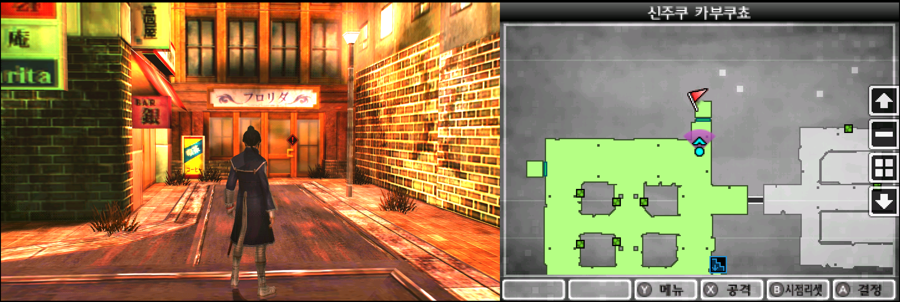
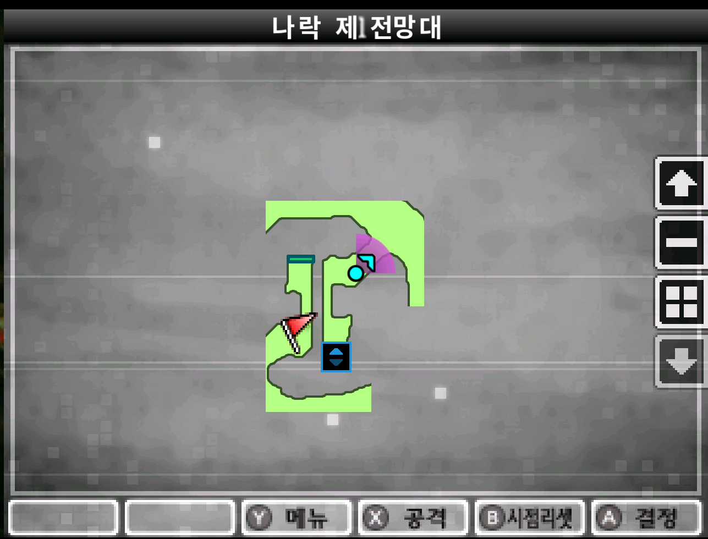
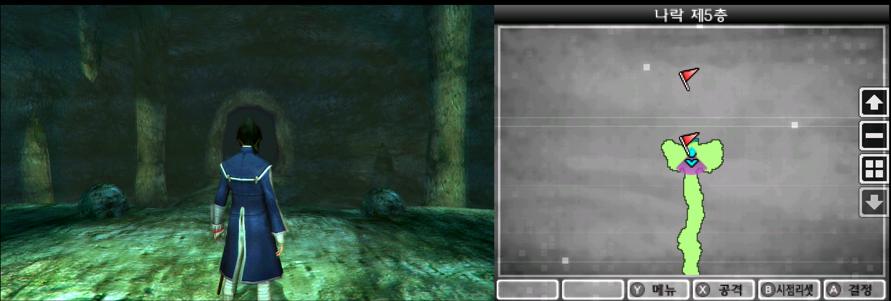
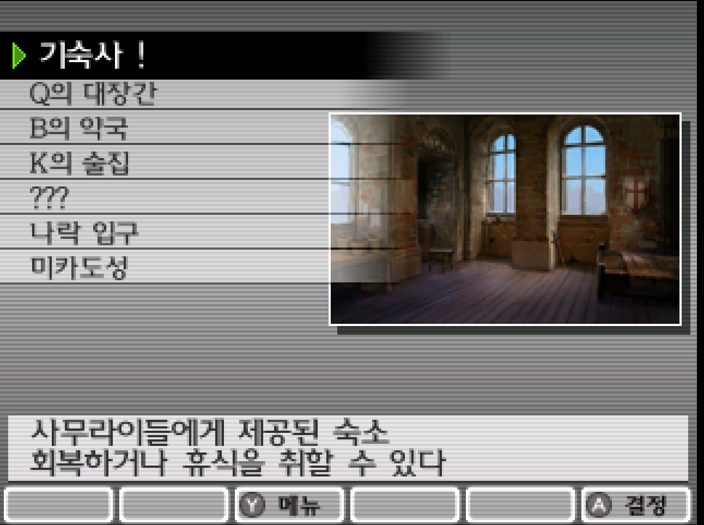

# 진·여신전생4 한국판 퀘스트 목적지 표시 모드

**SMT IV KR Quest Markers** — 진·여신전생4(3DS, 한국어 정식판)의 지도 화면에 **스토리 이벤트 위치를 『진·여신전생4 파이널』의 목적지 깃발로 표시**해 주는 모드입니다.

후속작 『진·여신전생4 파이널』은 지도에서 퀘스트 목적지를 보여 주지만, 4편에는 그런 기능이 없어 다음에 어디로 가야 할지 헤매기 쉽습니다. 이 모드는 게임 데이터에 들어 있는 이벤트 발동 위치를 읽어서, 지금 진행할 수 있는 이벤트를 **게임 속 지도 화면에 직접** 표시합니다.


<sub>메인 퀘스트 「평범한 '일상'으로 돌아가자」 진행 중. 목적지인 카페 입구에 마커가 떠 있습니다.</sub>

---

## 주요 기능

### 1. 지도에 목적지 깃발 표시
- 지금 진행할 수 있는 스토리 이벤트 위치에 **파이널과 같은 빨간 깃발**이 표시됩니다. 지도를 축소하면 작은 깃발로 바뀝니다.
- 이벤트를 진행하면 표시가 자동으로 사라집니다. 게임의 이벤트 플래그를 그대로 따릅니다.
- **아직 탐색하지 않은 구역**에 있는 목적지도 보입니다.

<p align="center">
  
  &nbsp;
  
</p>
<p align="center"><sub>왼쪽: 나락 제1전망대 &nbsp;|&nbsp; 오른쪽: 나락 제5층. 아직 가 보지 않은 회색 구역의 목적지도 보입니다.</sub></p>

- 같은 장소에 몰려 있는 이벤트는 깃발 하나로 합쳐서 보여 줍니다.
- 마을 사람 대사 갱신 같은 사소한 이벤트는 표시하지 않습니다.

### 2. 미카도국(선택지로 이동하는 마을)에 표시
메뉴에서 장소를 고르는 마을에서는 장소 이름 뒤에 기호가 붙습니다.

| 표시 | 의미 |
|---|---|
| `빵집 ！` | 메인 이벤트가 있음 |
| `기숙사 ＊` | 지금 시점에만 볼 수 있는 이벤트가 있음 |
| (표시 없음) | 중요하지 않은 이벤트이거나 이벤트가 없음 |

<p align="center">
  
  <br><sub>미카도국 장소 목록. 이벤트가 있는 「기숙사」 뒤에 "!"가 붙었습니다.</sub>
</p>

---

## 지원 버전

| 항목 | 값 |
|---|---|
| 게임 | 진·여신전생4 (한국어 정식판) |
| 제품 코드 | CTR-P-AMXK |
| 타이틀 ID | `00040000000F6100` |
| 확인한 환경 | Azahar 에뮬레이터 |

> 일본판·북미판에서는 동작하지 않습니다. 코드 패치가 한국판 실행 파일 기준으로 만들어져 있습니다.

---

## 설치 방법 (Azahar)

1. [Releases](../../releases)에서 최신 버전 압축 파일을 받습니다.
2. Azahar 게임 목록에서 **진·여신전생4를 우클릭 → Open Mods Location**(모드 위치 열기)을 누릅니다.
3. 열린 폴더에 압축 안의 `00040000000F6100` 폴더 **내용물**(`romfs`, `exefs`)을 그대로 넣습니다.

설치 후 폴더 구조는 다음과 같아야 합니다.

```
%APPDATA%\Azahar\load\mods\00040000000F6100\
 ├ exefs\
 │  └ code.ips                       ← 미탐색 구역에도 마커를 보이게 하는 코드 패치
 └ romfs\
    ├ map\all\MapNaviTable.tbb       ← 지도 마커 데이터
    ├ mikado\MikadoTable.tbb         ← 미카도국 장소 이름 표시
    └ tex\
       ├ icon.ttd                     ← 깃발 아이콘 정의 추가
       └ stex\icon\automap_icon3.stex ← 지도 아이콘 그림판에 깃발 그림 추가
```

> `00040000000F6100` 폴더 안에 또 `00040000000F6100` 폴더가 생기지 않도록 주의하세요.
>
> **업데이트할 때는 폴더를 지우지 말고 덮어쓰기만 하세요.** 같은 폴더에 다른 모드 파일(예: 폰트 모드)을 함께 쓰고 있다면, 폴더를 지울 때 그 파일도 사라집니다.

### 제거
위 다섯 파일을 지우면 원래 게임으로 돌아갑니다. 세이브 데이터는 건드리지 않으므로 언제든 넣고 뺄 수 있습니다.

### 실기(3DS) 사용
Luma3DS의 게임 패치 기능(LayeredFS)으로도 같은 구조로 적용할 수 있을 것으로 예상하지만, 실기에서는 아직 테스트하지 않았습니다.

---

## 알려진 제한

- **도쿄 필드 맵**(넓은 바깥 지도)은 **시험 지원** 중입니다. 필드 지도는 아이콘 좌표를 실제 게임 좌표 그대로 쓰기 때문에 같은 방식으로 깃발을 넣었지만, 아직 게임에서 표시를 확인하지 못했습니다.
- **챌린지 퀘스트**(퀘스트 센터의 의뢰) 목적지는 표시하지 않습니다. 스토리 이벤트만 표시합니다.
- 모든 깃발이 같은 빨간색입니다. 메인·서브·챌린지를 색으로 구분하는 기능은 계획 중입니다.
- 이벤트 데이터에 정확한 위치가 없는 일부 이벤트는 표시되지 않습니다. 예를 들어 구역에 들어가기만 하면 발동하는 이벤트가 그렇습니다.
- 깃발은 "메인 퀘스트의 다음 목적지"가 아니라 **"지금 일어날 수 있는 스토리 이벤트의 발동 지점"** 입니다. 그래서 퀘스트 목록에 없는 이야기 이벤트에도 깃발이 뜨고, 한 층에 깃발이 여러 개 보일 수 있습니다. 정상 동작입니다.

---

## 원리 (궁금한 분들을 위해)

| 파일 | 하는 일 |
|---|---|
| `MapNaviTable.tbb` | 게임 지도 아이콘 표입니다. `MapHaichiTable.tbb`(이벤트 배치 표)에 적힌 이벤트 위치와 시작·종료 플래그를 읽어, 깃발 아이콘 행을 추가했습니다. 시작 플래그가 켜져 있고 종료 플래그가 꺼져 있을 때만 게임이 그립니다. |
| `code.ips` | 지도 아이콘이 "발견한 방"에서만 보이도록 검사하는 함수(`0x24D360`)를 고쳐서, 특정 방 번호(64 이상)는 항상 보이게 합니다. 원래 게임 아이콘은 이 번호를 쓰지 않아 영향이 없습니다. |
| `MikadoTable.tbb` | 미카도국 장소 이름 뒤에 "！" 또는 "＊"를 붙인 버전을 이벤트 조건에 맞춰 추가했습니다. |
| `automap_icon3.stex` | 지도 아이콘 그림판(128×128)입니다. 진여신4는 흑백 형식이라 빨간 깃발을 담을 수 없어서, 파이널과 같은 컬러 형식(RGBA4)으로 바꾸고 빈 자리에 파이널의 깃발 그림(20×20, 10×10)을 옮겼습니다. 기존 아이콘은 위치·모양이 그대로입니다. |
| `icon.ttd` | 아이콘 정의 표입니다. 지도 아이콘 그룹 끝에 깃발 2개(그림 번호 7110 큰 깃발, 7111 작은 깃발)를 추가했습니다. |

원래 게임 데이터의 행은 수정하지 않고 **새 행만 추가**하므로, 기존 아이콘과 이벤트 동작에는 영향이 없습니다.

---

## 직접 만들기 (`tools/`)

모드 파일은 모두 정품 게임 데이터에서 스크립트로 만듭니다. 저장소에는 게임 파일이 없으므로, 직접 추출한 romfs/exefs가 필요합니다. (Python 3, numpy 필요)

| 스크립트 | 입력 | 출력 |
|---|---|---|
| `make_markers.py` | 진여신4 romfs 폴더 | `MapNaviTable.tbb` |
| `make_ips.py` | 진여신4 `exefs/code.bin` | `code.ips` |
| `make_mikado.py` | 진여신4 `mikado/MikadoTable.tbb` | 수정된 `MikadoTable.tbb` |
| `make_flag.py` | 진여신4 romfs, 파이널 romfs | `tex/icon.ttd`, `tex/stex/icon/automap_icon3.stex` |

```
python tools/make_markers.py <진여신4 romfs> MapNaviTable.tbb
python tools/make_ips.py <진여신4 exefs>/code.bin code.ips
python tools/make_mikado.py <진여신4 romfs>/mikado/MikadoTable.tbb MikadoTable.tbb
python tools/make_flag.py <진여신4 romfs> <파이널 romfs> out
```

> 깃발 그림은 『진·여신전생4 파이널』의 데이터에서 가져오므로, `make_flag.py`를 쓰려면 파이널의 romfs도 필요합니다.

---

## 크레딧

- 모드 제작: [Heerelli](https://github.com/Heerelli)
- 분석·도구 제작 도움: Claude (Anthropic)
- 진·여신전생4 © ATLUS. 이 저장소에는 게임 원본 파일이 들어 있지 않으며, 정품 게임을 가진 분만 사용할 수 있습니다.
